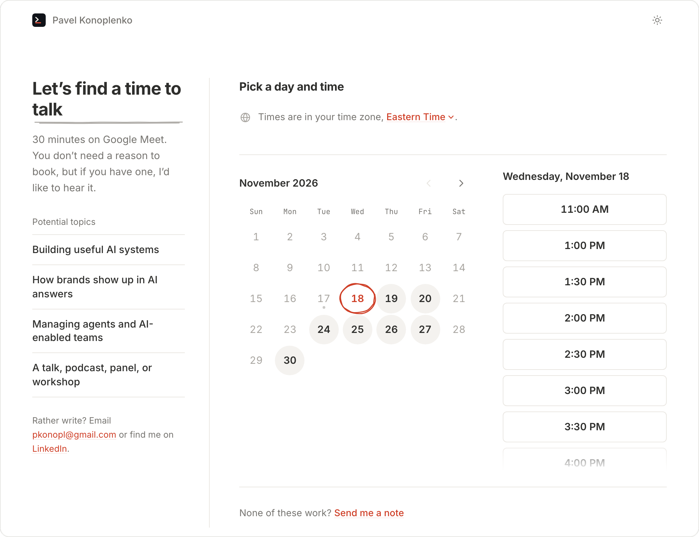
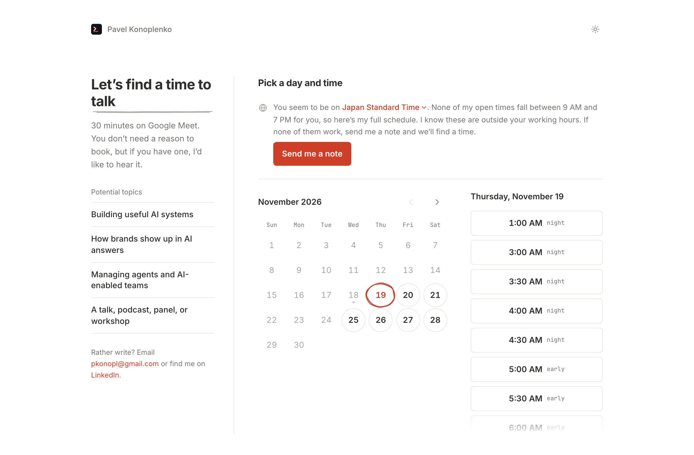

# Schedulum

A booking page for one person, on your own domain. Visitors see your open
times on their own clock, pick one, and get a Google Calendar invite with a
Meet link. It runs as a single Cloudflare Worker and books straight into
Google Calendar, with no database and no scheduling service in between.

It's the code behind [meet.pavelnovel.com](https://meet.pavelnovel.com).

<picture>
  <source media="(prefers-color-scheme: dark)" srcset="docs/screenshots/calendar-dark.png">
  
</picture>

## What a visitor sees

The calendar comes first. Nobody has to choose a topic or a meeting type
before they see a time. On a wide screen, one click on a time opens the form:
name, email, and one optional question. Google Calendar sends the
invite, and the invite carries a private link to reschedule or cancel.

Times are in the visitor's time zone, taken from their device. When
Cloudflare's guess from their IP address disagrees, as it does on a VPN, the
page offers a one-click switch. By default it shows only the times that fit
inside the visitor's own 9 AM to 7 PM, and one link shows the rest.

When none of your open times fall in the visitor's day, the page says so,
shows the full schedule anyway, and offers a note. The note goes to your
inbox from your own Gmail address, with the visitor as the reply-to.

<picture>
  <source media="(prefers-color-scheme: dark)" srcset="docs/screenshots/full-schedule-dark.png">
  
</picture>

Topics are optional. Each one has its own link, such as `/speaking`, that
opens the calendar with the topic already picked. Picking a topic shows a few
lines about it and swaps the form's question for that topic's own.

## How it works

```text
Astro static pages: the booking page, one page per topic, privacy
  └─ src/scripts/booker.ts      calendar, time picker, form, and note
One Cloudflare Worker, which also serves the static pages
  ├─ GET  /api/slots            open times for a meeting length
  ├─ POST /api/book             spam check, re-checks the time, creates the event
  ├─ POST /api/manage           reschedule or cancel, by signed token
  ├─ POST /api/note             spam check, then one email to you
  ├─ PUT  /api/busy             busy times pushed from another server
  └─ GET  /manage/<token>       the guest's reschedule or cancel page
src/lib/
  ├─ availability.ts            working hours minus busy blocks, as slots
  ├─ hours.ts, fit.ts           the visitor's hours, and what the page tells them
  ├─ booking.ts                 booking rules, independent of HTTP
  ├─ calendar.ts                the interface a calendar provider implements
  ├─ google.ts                  Google Calendar over fetch
  ├─ note.ts                    a visitor's note, sent through Gmail
  ├─ synced.ts                  merges pushed busy times with Google's
  ├─ turnstile.ts               Cloudflare Turnstile verification
  └─ fake.ts                    an in-memory calendar for development and tests
scripts/push-busy.mjs           runs on a server, sends other accounts' busy times
```

A single Cloudflare Durable Object queues calendar changes across personal and work bookings.

Google Calendar handles delivery: the invite email, updates, cancellations,
reminders, and the Meet link. A guest's name, email, and note go only into
the calendar event, and a note goes only into one email to you. Schedulum
itself stores only busy times from calendars on other Google accounts, such as
a work calendar. An optional job pushes them every 10 minutes.

Bookings and notes pass Cloudflare Turnstile. One email address can hold at
most two upcoming bookings, and Gmail dots and `+` aliases count as the same
address.

## Run your own

You need a Google account for the calendar and a Cloudflare account. A domain
is optional: without one, the page runs at
`schedulum.<your-subdomain>.workers.dev`.

Fork the repository, then replace what's Pavel's:

| File | What to change |
| --- | --- |
| [`src/config.ts`](src/config.ts) | Your name and links, working hours, meeting length, and topics |
| [`wrangler.toml`](wrangler.toml) | Your domain and `PUBLIC_URL`, or delete both to use `workers.dev`; your KV namespace ID, or delete that block |
| [`astro.config.mjs`](astro.config.mjs) | `site`, the page's public address |
| [`.env.production`](.env.production) | The site key of your own Turnstile widget |
| [`src/pages/privacy.astro`](src/pages/privacy.astro) | Your privacy page |

Then follow [SETUP.md](SETUP.md) to create a Google OAuth client, connect
your calendar, and deploy.

Google Calendar is the only provider so far. The rest of the app talks to the
`Calendar` interface in [`src/lib/calendar.ts`](src/lib/calendar.ts), so
adding Outlook or CalDAV means a new file beside `src/lib/google.ts`, chosen in
`src/lib/env.ts`.

## Develop

You need Node.js 22.23.4 or later.

```bash
npm ci
test -f .dev.vars || (umask 077 && cp .dev.vars.example .dev.vars)  # local demo
npm run dev                      # http://localhost:4321
npm test                         # unit tests
npx playwright install chromium  # once per test machine
npx playwright test              # browser and accessibility tests, with the dev server running
```

## License

[MIT](LICENSE)
